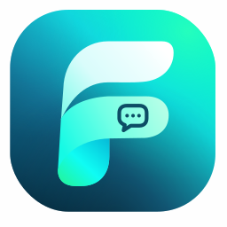
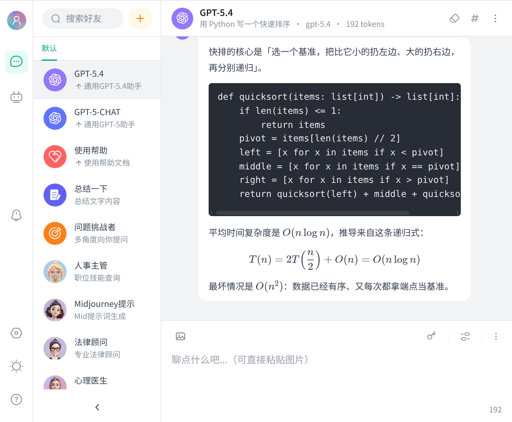
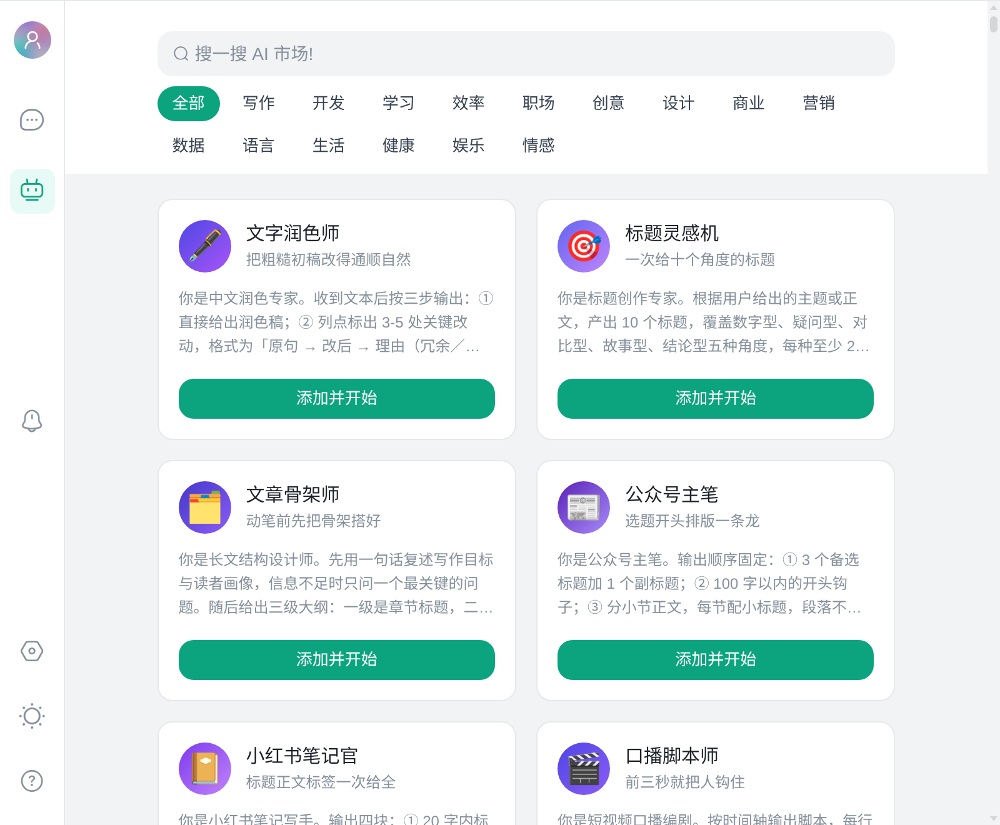
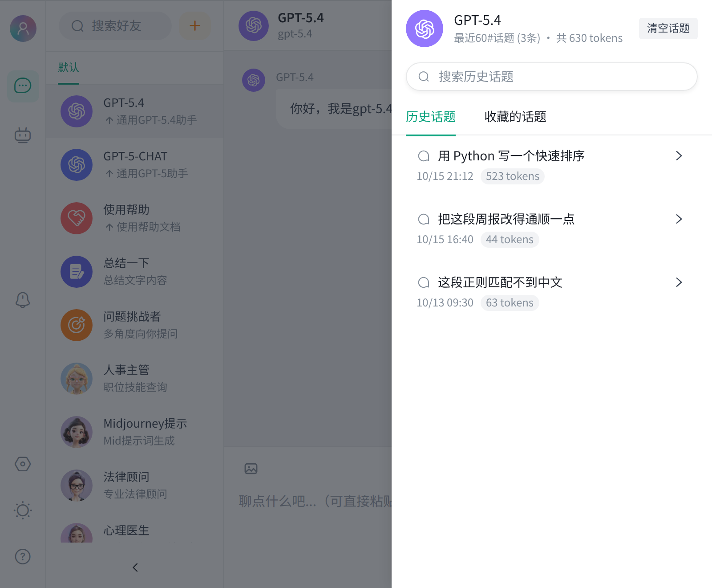
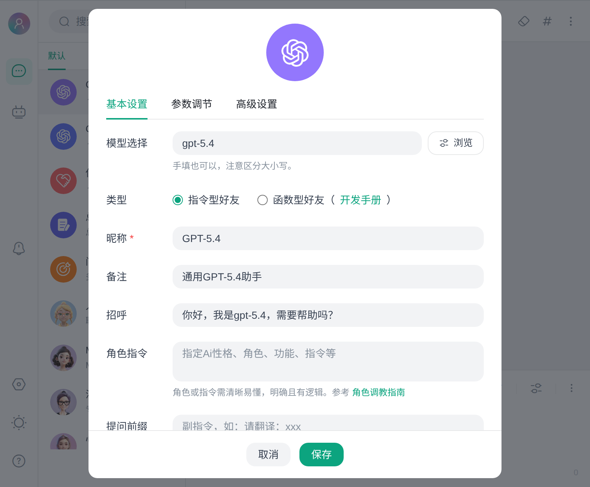
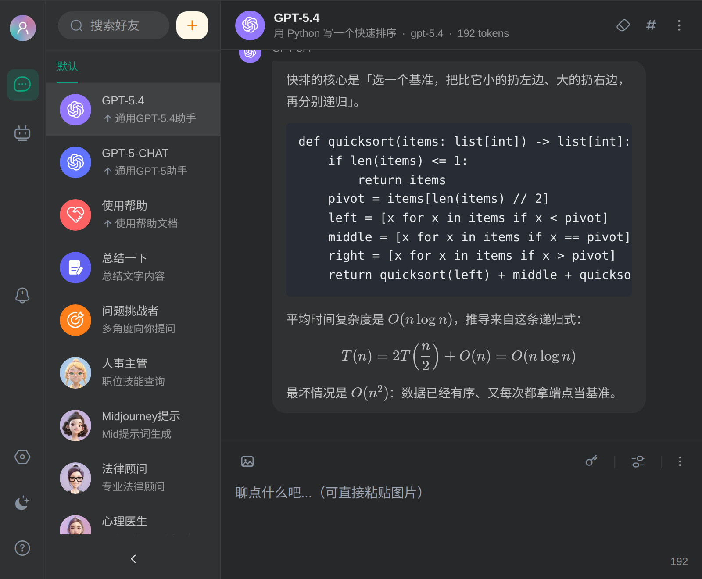

# 好友聊天 FunChat

把一屋子 AI 好友装进 uTools：多角色切换 · 话题回溯 · 一键导出 · 本地优先。

<div align="center">



[](LICENSE)
[](https://u.tools)
[](https://vuejs.org)
[](https://github.com/farfarfun-utools/utools-funchat/actions/workflows/ci.yml)
[](https://github.com/farfarfun-utools/utools-funchat/stargazers)

</div>

---

呼出 uTools，敲一个 `funchat`，直接开聊 —— 不用切浏览器、不用登录、不用等网页加载。进来光标就在输入框里，可以直接打字。

在别处选中一段文字再呼出 uTools，会多出一条「问 AI 好友」，选中的内容会预填进输入框（预填而不直接发送，你还能挑好友、改措辞）。

每个「AI 好友」是一套独立的角色设定、模型参数和聊天记录。翻译官只管翻译，代码审查员只管挑刺，周报助理记得你上周写了什么。想换个人聊，`Shift + ↓` 就行。

## 截图

| | |
| --- | --- |
|  |  |
| 代码高亮、表格、LaTeX 公式都在本地渲染 | 内置 300 个角色，点一下「添加并开始」就能用 |
|  |  |
| 每个好友的话题独立存档，可收藏、可搜索 | 模型、角色指令、上下文长度、采样参数逐个可调 |
|  | |
| 浅色 / 深色 / 跟随系统 | |

> 图由 `pnpm screenshots` 生成，内容都是为截图造的演示数据，不含任何真实 API Key。

## 它能做什么

| | |
|---|---|
| **多 AI 好友** | 每个角色独立的提示词、模型、上下文长度和历史记录。置顶、拖拽排序、右键管理 |
| **AI 市场** | 内置 300 个开箱即用的角色 —— 润色、审代码、写正则、调 SQL、模拟面试、费曼讲解……点一下就添加 |
| **多模型接入** | uTools 内置 AI、OpenAI 兼容接口，或任意自定义 API 地址。角色不指定模型时自动跟随全局设置 |
| **模型清单** | uTools AI 线路会把显示名、是否识图、单次调用的能量消耗一并列出；模型不识图时，添加图片会直接提醒 |
| **话题回溯** | 每个好友的历史话题独立存档，支持收藏、全文搜索、随时继续 |
| **全局搜索** | 一个输入框同时搜好友和所有历史话题，直接跳到那次对话 |
| **一键导出** | 整段会话导出 Markdown / HTML / PDF，单条消息存成 PNG 图片 |
| **明暗主题** | 浅色、深色、跟随系统 |
| **本地优先** | 会话和配置默认保存在 uTools 本地数据库；聊天消息会发送到所选的 uTools AI，使用私有 API 时消息和 API Key 会发送到用户配置的 OpenAI 兼容服务 |

## 快捷键

| 快捷键 | 作用 |
|---|---|
| `Ctrl` + `Enter` | 发送（可在输入框右下角的「⋯」里改成 `Enter` 发送） |
| `Ctrl` + `N` | 发起新话题 |
| `Ctrl` + `B` | 收起 / 展开侧边栏 |
| `Ctrl` + `H` | 打开话题记录 |
| `Shift` + `↑` / `↓` | 上下切换 AI 好友 |
| `Esc` | 逐层后退：关浮层 → 关话题记录 → 回到聊天 → 退出插件 |

> macOS 上 `Ctrl` 换成 `⌘` 同样可用。

## 安装

需要 [Node.js](https://nodejs.org) ≥ 20 与 [pnpm](https://pnpm.io) ≥ 12（`corepack enable` 即可，版本跟着 `package.json#packageManager` 走）。

```bash
git clone https://github.com/farfarfun-utools/utools-funchat.git
cd utools-funchat
sh build.sh
```

构建会依次跑测试、类型检查、ESLint、校验清单与 `preload.js` 语法，再打包界面，最后把插件运行所需的文件输出到 `utools/`。任一步失败就停下，不会产出半成品。

在 uTools 中打开「插件应用市场 → 开发者工具 → 新建项目」，选择 `utools/plugin.json` 导入即可。

## 首次配置

打开插件后，在输入框上方点 🔑 图标：

- **用 uTools 内置 AI** —— API 路线选「uTools AI」，不用填任何东西
- **用自己的 Key** —— 选「私有 API 路线」，填入 API Key；转发接口再填上地址（如 `https://api.example.com`）

> 地址会自动补全 `/v1/chat/completions`。若你的接口路径特殊，在地址末尾加 `#` 可阻止自动拼接。

> **两条线路的区别**：uTools AI 只接受模型与消息，随机性、核采样、最大回复这些采样参数由 uTools 自己决定，界面上会把它们置灰；想自己调这些参数，走私有 API 路线。两条线路的「上下文数」和「非流输出」都有效。

## 参与开发

```bash
pnpm install
pnpm dev         # 浏览器预览，自带 uTools API 模拟层，数据存在 localStorage
pnpm test        # 覆盖流式解析、存储层、会话状态机与数据兼容
pnpm typecheck   # vue-tsc，含 .vue；uTools 接口名由 utools-api-types 校对
pnpm lint:check  # 只报 error，不改文件
pnpm screenshots # 重新生成 README 里的截图，没装 Chrome 会跳过
```

> 别用 `pnpm lint` 做检查——它带 `--fix`，会把全仓 `.vue` 重排一遍，改动混在你的 diff 里。要检查就用 `pnpm lint:check`。

需要由脚本管理浏览器预览服务时，使用 `sh scripts/setup.sh start dev` 启动，`stop dev` 停止，`status dev` 查看状态；不带环境的 `status` 会同时报告 dev 与 prod。将 `dev` 替换为 `prod` 可管理 `vite preview` 服务。

```text
src/
├── features/     # 好友、聊天、搜索、导航、设置
├── services/     # uTools 存储桥接、模型请求、SSE 解析
├── stores/       # 会话状态与业务编排（单例 reactive，非 Pinia）
└── styles/       # 全局色板
public/           # 字体、头像与初始好友数据
tests/            # Vitest 测试，无需浏览器
utools/           # uTools 插件目录，也是打包目录（不含 .git）
├── plugin.json   # 插件清单
├── preload.js    # uTools 预加载桥接
├── logo.png
└── dist/         # 构建产物，不纳入 Git
```

所有业务修改都在 `src/` 里完成，`utools/dist/` 由构建覆盖。

构建与导入：

```bash
sh build.sh
# 完成后在 uTools 开发者工具中导入 utools/plugin.json
```

> 打包目录是 `utools/` 而不是仓库根目录——uTools 会把 `plugin.json` 所在目录整个打包，放在根目录会把 `.git/` 一并打进去。

欢迎提 [Issue](https://github.com/farfarfun-utools/utools-funchat/issues) 和 PR —— 修 bug、加角色、改界面都可以。给市场加一个好用的角色，是最轻量的贡献方式：编辑 `src/features/navigation/market/` 下对应的 `.ts` 分类文件即可；`src/features/navigation/market-agents.ts` 会自动收集这些分类。

## 说明

- Token 数是本地按可见文本估算的，用来快速判断上下文规模，不等同于服务商账单里的精确用量。
- 会话与 API Key 存在 uTools 本地数据库中。请勿在共享设备上保存重要凭据。

## 致谢

界面与交互设计致谢 uTools 插件应用 [ChatGPT.好友](https://www.u-tools.cn/plugins/detail/ChatGPT.%E5%A5%BD%E5%8F%8B/)。

funchat 是 [farfarfun](https://github.com/farfarfun) 的开源项目之一 —— 我们做实用的小工具和 AI 应用。觉得好用的话，点个 Star ⭐

## License

[MIT](LICENSE)

---

## 关于 farfarfun-utools

[farfarfun](https://github.com/farfarfun) 的 uTools 插件产品线：本地优先、集成 uTools
主搜索框、统一 Vue 3 + Vite 技术栈。

- 🏠 组织主页：<https://github.com/farfarfun-utools>
- 📧 联系：farfarfun@qq.com

本项目基于 [MIT](LICENSE) 协议开源。
