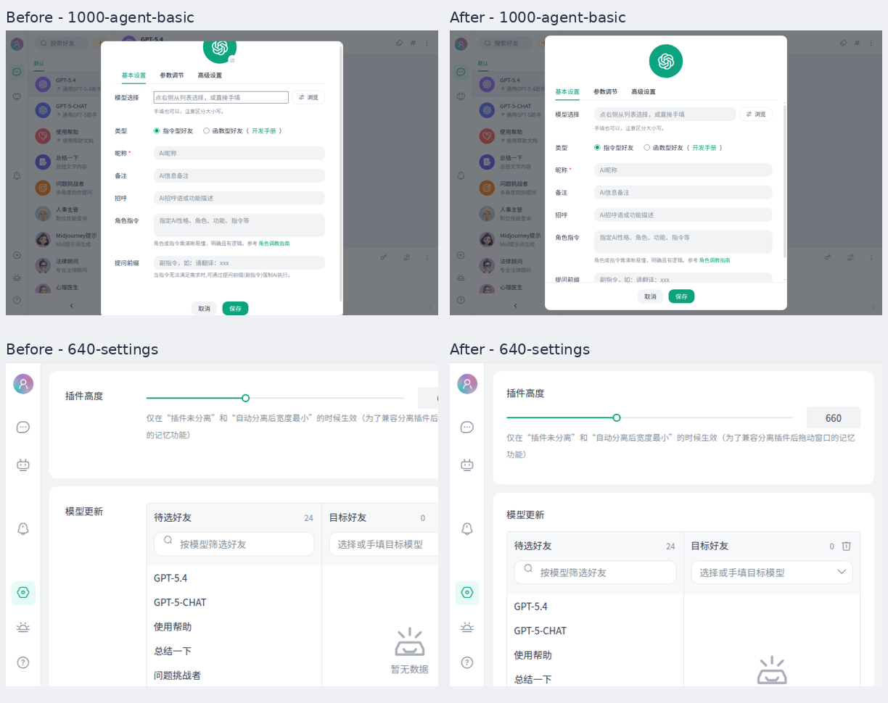

# 页面布局检查与修复

本轮沿用现有配色、组件和导航结构，重点检查完整显示、滚动边界、窄窗口适配和操作入口。

下图左侧为修复前，右侧为修复后：上排是好友编辑弹窗，下排是 640px 宽的设置页。

| 页面／区域 | 确认的问题 | 本次处理 |
| --- | --- | --- |
| 好友编辑弹窗，三个分页 | 头像使用负数定位；短窗口启用滚动后头像上沿被裁切，保存按钮也可能需要滚动才能找到 | 头像回到正常布局，正文单独滚动，头像、分页和保存／取消按钮留在可视区 |
| 好友编辑，高级设置 | 问题示例只排一行，长内容挤掉后续输入；非流输出开关缺少可点击标签；头像上有未实现功能的编辑图标 | 示例支持换行，开关可通过可见区域点击，移除无实际操作的头像编辑标记；统一模型输入框样式 |
| 聊天、API 绑定 | 好友列表展开后占满窄窗口；收起时连主导航也隐藏；绑定表单固定高度不适合标题换行 | 窄窗口自动收起好友栏，展开时覆盖列表区域，选人后收起；主导航保留；绑定表单按内容撑高 |
| API 路线和临时参数面板 | 固定宽高导致面板在窄／矮窗口中越界，标题、字段可能被截断 | 限制在会话宽度及窗口可用高度内，字段可滚动，API 保存按钮保留；小窗口中线路列表与表单上下排列 |
| 设置：插件高度、批量模型、备份 | 小窗口反而强制卡片至少 650px；模型列表和按钮固定宽度；说明文字固定行高容器发生溢出 | 删除强制最小宽度，列表、按钮随容器伸缩；窄窗口改为纵向布局，说明文字自然换行 |
| AI 市场 | 卡片最小宽度超过窄窗口可用区域 | 卡片最小宽度受容器约束，调整窄窗口左右留白 |
| 通知 | 左侧固定 240px，窄窗口中正文被挤成很窄的一列 | 窄窗口中通知列表放到正文上方，列表和正文各自可滚动 |
| 帮助 | 固定双列正文、三列链接，在窄窗口中过度换行 | 窄窗口改为单列，减少卡片内边距 |
| 话题记录 | 缺少明确的关闭按钮，小窗口下遮罩区域很难点击 | 增加关闭按钮，长角色名称和清空按钮保留各自空间 |
| 消息、模型选择、导出菜单、图片预览、确认弹窗 | 检查长名称、窄窗口、弹层边界 | 调整窄窗口消息留白和图片宽度；其余通过浏览器边界检查 |

## 验证方式

- `pnpm test:layout`：使用现有 CDP 工具和本机 Chromium，无新增依赖；运行时自动启动并关闭本地 Vite 服务。
- 浏览器覆盖浅色／深色主题，以及 1000×660、800×600、640×480、375×667、667×375 五种视口；使用独立临时浏览器配置，不接触真实聊天数据，不调用真实 AI 服务。
- 检查头像上沿是否真正可见、弹窗按钮是否在窗口内、页面是否横向溢出、窄窗口选人后能否收起列表、开关能否点击、长问题示例是否换行、历史面板能否关闭。
- 执行现有单元／DOM 测试、类型检查、Lint 和生产构建。

浏览器验证不等同于 uTools 原生客户端实测；系统字体、操作系统缩放及不同版本客户端仍需现场确认。本轮不新增头像编辑器，也不重做整体视觉风格。
